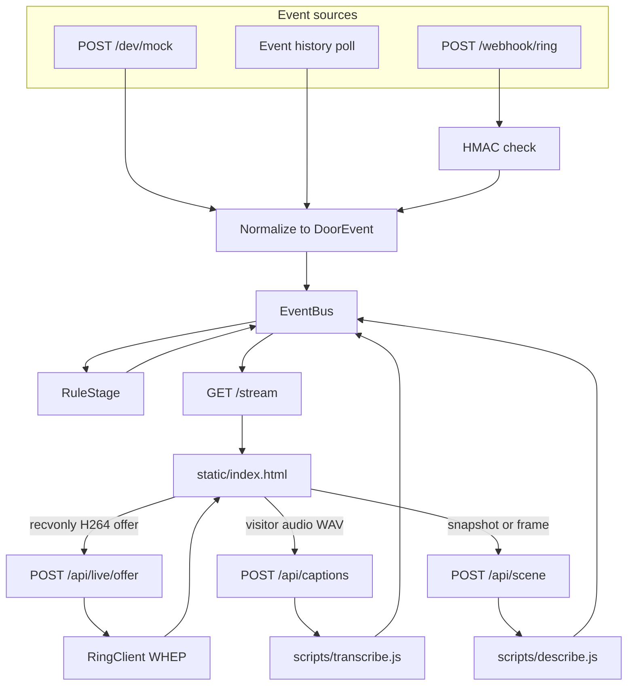

# Ring

Track repo for the Amazon Developer Hackathon. This folder is the whole project: rules, sponsor context, the research prompt, the research report, and `oss/` (a standalone library for the Open Source mini-challenge). It does not depend on any other local folder.

- **Hackathon:** Build, Ship, Shape: Amazon Developer Hackathon
- **Deadline:** 23 Oct 2026, 12:00 PM PT
- **Track:** A new or extended app on Ring APIs, SDKs, simulators, or devices. Sponsor themes include access control, business systems, home automation, accessibility, and caretaking. Facial recognition and license-plate reading are out.

## App

**Door Interpreter** — a deaf or hard-of-hearing resident reads the door. A ring flashes a high-contrast alert, the live picture plays, the visitor's words become a caption, and one sentence says what is there. The sentence is chosen from a fixed list, so nobody is identified.

The research report recommended SignSync. The Ring docs and the Playground device changed that: streams are receive-only, this doorbell speaks H264 only, and it cannot talk back. Sign recognition is not in this build.

## Architecture

Door Interpreter is a FastAPI service in `src/ringdoor/`. Every doorbell event becomes the same `DoorEvent`, regardless of source. A small pipeline turns that event into an alert. The browser subscribes to those alerts and, on its own, opens the live picture, captions, and scene sentence.



Three sources share one path. `RINGDOOR_SOURCE` selects which one runs.

| Source | When to use it | What it does |
|---|---|---|
| `mock` | Local demo, no Ring account | `POST /dev/mock/button_press` or `motion_detected` builds a v1.1 webhook envelope |
| `poll` | Playground token | `RingClient` reads event history on an interval. The first pass records existing ids and does not replay them as new alerts |
| `webhook` | Partner callback | `X-Signature` is checked, duplicate `request_id`s are dropped, and the handler returns 200 before the pipeline runs |

`RuleStage` is the only stage registered today. A button press becomes a visitor alert. Motion becomes a motion alert, using the event subtype when Ring sends one (`human`, `package_delivery`, `vehicle`). A stage that throws is logged and skipped, so a later stage cannot drop the baseline alert.

The page does not wait on the server for media. After a visitor alert it builds a receive-only H264 WebRTC offer and posts the SDP to `/api/live/offer`. `RingClient` forwards that offer to Ring's WHEP endpoint and returns the answer plus a session URL. Closing the page calls `/api/live/close`. Offers that are not receive-only, or that omit H264, are rejected before they reach Ring.

Captions and the scene sentence are separate requests, both published back onto the same bus:

- The browser buffers visitor audio, downsamples it to 16 kHz WAV, and posts it to `/api/captions`. `scripts/transcribe.js` uses macOS speech recognition.
- `/api/scene/ring` downloads a Ring snapshot when credentials exist. Otherwise the page posts a JPEG of the current frame to `/api/scene`. `scripts/describe.js` returns labels, and `scene.py` maps those labels onto a fixed sentence list. A package outranks a person. Names are never produced.

| Module | Responsibility |
|---|---|
| `config.py` | Environment: source, tokens, HMAC key, device id, poll interval |
| `ring_client.py` | Partner API client. Playground access token or OAuth refresh. Devices, history, snapshot, WHEP |
| `events.py` | `DoorEvent`, webhook and history normalization, in-memory `EventBus` with replay |
| `webhook.py` | HMAC verification of the raw body |
| `sources.py` | Mock envelopes and the history poller |
| `pipeline.py` | `Alert` model and `RuleStage` |
| `live.py` | SDP checks and session-URL allowlist |
| `captions.py`, `scene.py`, `mac.py` | Local speech and vision adapters |
| `main.py` | HTTP routes and process lifespan |
| `static/index.html` | Retro television UI: alert, live picture, caption, scene line, tonight log |

| Method | Path | Purpose |
|---|---|---|
| `GET` | `/` | Television page |
| `GET` | `/stream` | Server-sent events. Replays history, then live `event`, `alert`, `caption`, and `scene` messages |
| `GET` | `/api/recent` | Current bus history |
| `POST` | `/api/log/clear` | Clears that history |
| `POST` | `/webhook/ring` | Signed Ring webhook |
| `POST` | `/api/live/offer` | Forwards a receive-only H264 offer |
| `POST` | `/api/live/close` | Ends the WHEP session |
| `POST` | `/api/captions` | WAV in, caption text out |
| `POST` | `/api/scene` | JPEG in, one sentence out |
| `POST` | `/api/scene/ring` | Snapshot from Ring, then the same sentence |
| `GET` | `/api/devices` | Devices on the configured token |
| `POST` | `/dev/mock/{kind}` | Present unless `RINGDOOR_SOURCE=webhook` |

## Recommended build

**SignSync:** doorbell video is reduced to hand and body landmarks, and the sign is sent to the resident as text. Faces are dropped. Rubric total 37, ahead of AuraDoor (34) and HapticHome (30).

The report's own formula is about $460k a year (1% of an estimated Ring-reachable base at $7.99). The executive summary also says $45M, which does not match that formula. Switch to AuraDoor if the RTSP stream is too unstable for frame analysis, or if translation takes more than 3 seconds.

## Docs

| File | What it is |
|---|---|
| [HACKATHON.md](HACKATHON.md) | Full hackathon rules and dates, copied so this repo stands alone |
| [ORG.md](ORG.md) | Amazon, AWS, and device-team goals, copied so this repo stands alone |
| [PROMPT.md](PROMPT.md) | Deep-research prompt for this track |
| [SignSync-AI-Deep-Research-Report.md](SignSync-AI-Deep-Research-Report.md) | Research report and the three pitches |
| [oss/](oss/) | Standalone Ring webhook receiver and hand-landmark helper (MIT) |
| [SUBMISSION.md](SUBMISSION.md) | Door Interpreter submission copy and friction log |

## Run

```bash
python3 -m venv .venv && .venv/bin/pip install -r requirements.txt
cp .env.example .env            # optional: RING_ACCESS_TOKEN from the Playground
.venv/bin/python -m pytest -q
sh scripts/demo.sh              # http://localhost:8000
```

Press **Ring** on the set. With a Playground token in `.env`, the **Tune** knob opens the live view. The offer must be receive-only H264; a VP8 offer gets a 500 from Ring. **Scene** turns a snapshot into one sentence. Captions and that sentence use macOS speech and vision.

The service layout, event path, and routes are in [Architecture](#architecture).

```bash
.venv/bin/python scripts/ring_probe.py --token "<playground token>"
```

**Verified against Ring (2026-10-18):** WHEP, `recvonly`, H264, max 30 s (battery) / 60 s (line-powered). No talkback. Audio playback is for chimes. Webhooks use `X-Signature: sha256=<hex HMAC of raw body>`, must return 200 in 5 s, and the URL is set during partner onboarding. The Playground device is an online Doorbell Pro with an empty event history. Submission copy and the friction log are in [SUBMISSION.md](SUBMISSION.md).
