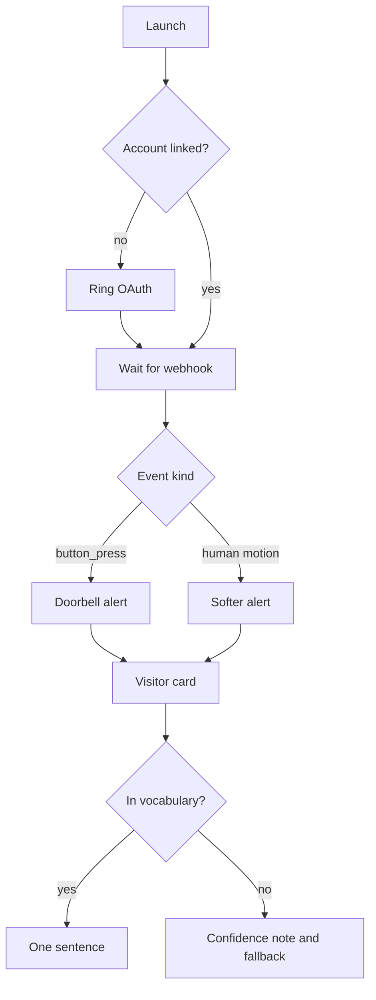

# Product Requirements (PRD)

**Project:** SignSync
**Date:** 2026-10-12
**Version:** 0.1
**Owner:** Xander
**Status:** Draft
**Last reconciled:** N/A
**IDEA:** [idea-signsync.md](idea-signsync.md)

---

## 1. Product Purpose & Value Proposition

SignSync tells a Deaf or hard-of-hearing resident that someone is at the door in a way they can perceive, then shows who and why as short text from hand and body landmarks. Faces are never analyzed. The demo is a Ring-track hackathon slice, not a store release.

---

## 2. Target Personas

**Primary: Doorstep resident**: A Deaf or hard-of-hearing person at a Ring doorbell. Pain: the bell or a person outside is not perceivable, or it is perceivable without meaning. Success: a distinct alert and a card that states the visit in one sentence.

**Secondary: Remote family**: Someone who may be notified from the app when the resident cannot answer. Pain: they learn only that motion happened. A named caregiver flow is [FILL]. Track builder: Xander.

---

## 3. Core Features & Priorities

IDs are permanent. Priority is MoSCoW.

| ID | Feature | Description | Priority |
|----|---------|-------------|----------|
| PRD-F1 | Perceivable alerts | button_press and human motion drive a distinct haptic, light, or chime pattern | Must-Have |
| PRD-F2 | Visitor card | High-contrast card with hands-only skeleton, text, and event time | Must-Have |
| PRD-F3 | Closed vocabulary | Hand and body landmarks map to a fixed doorstep list plus yes and no | Must-Have |
| PRD-F4 | One sentence | Recognized signs plus event context become one sentence and a confidence note | Must-Have |
| PRD-F5 | Face drop | Face landmarks are discarded before storage or any model call | Must-Have |
| PRD-F6 | Speech captions | Captions on the same card if visitor audio exists | Could-Have |
| PRD-F7 | Later scope | Open vocabulary, Filipino Sign Language, caregiver reports, store billing | Won't-Have |

---

## 4. User Stories & Acceptance Criteria

**US-1: Perceive the ring** (PRD-F1)

> As a resident, I want a distinct alert when the bell rings so that I know the visit started.

- Given a linked account, when a button_press webhook arrives, then the resident alert uses the doorbell pattern and the card opens.

**US-2: Read the visit** (PRD-F2, PRD-F3, PRD-F4)

> As a resident, I want the card to say what the visitor signed so that I know who needs what.

- Given a signed phrase in the closed list, when frames are ingested, then the card shows hands only and one sentence within the demo budget. The budget number is [FILL].

**US-3: Someone waiting** (PRD-F1)

> As a resident, I want a softer alert when a person lingers so that I can tell it from a bell press.

- Given motion_detected with a human sub_type that lingers, when the linger rule fires, then the alert and chime differ from the doorbell pattern. Linger duration is [FILL].

**US-4: No face stored** (PRD-F5)

> As a resident, I want my visitor's face left out so that the app does not recognize people by face.

- Given a frame, when landmarks are extracted, then face landmarks are gone before write and before the sentence call.

**US-5: Low confidence** (PRD-F3, PRD-F4)

> As a resident, I want a low-confidence result labeled so that I do not treat a guess as a fact.

- Given a sequence below the bar, when the card renders, then it shows the confidence note and the fallback line. The bar is [FILL]. Fallback candidate: fingerspelled YES and NO.

---

## 5. App Flow & UX Intent

**Design reference:** [dsd-signsync.md](dsd-signsync.md)

### 5.1 Screen Inventory

| Screen | Purpose | Entry points | States to design |
|--------|---------|--------------|------------------|
| Link account | Ring OAuth one-way link | First launch | empty / loading / error / success |
| Visitor card | Alert result and sentence | Webhook, demo deep link | empty / loading / error / success |
| Event list | Recent visits | Card back, app open | empty / loading / error / success |

### 5.2 Navigation Model & Information Architecture

**Primary navigation pattern:** One primary card. A short event list sits behind it.

| Destination | Maps to screen (§5.1) | Route / path | Auth required | Feature(s) |
|-------------|-----------------------|--------------|---------------|------------|
| Link | Link account | /link | Yes | PRD-F1 |
| Card | Visitor card | /card | Yes | PRD-F2 |
| Visits | Event list | /visits | Yes | PRD-F1 |

```
/link
/card
/visits
```

**Global elements, auth boundaries, deep links:** /card and /visits require a linked resident. Demo deep link is [FILL]. No public share token in this slice.

### 5.3 App Flow

**Linear (primary path):** Link account, then webhook, then card.



**Annotations (required; the diagram alone is not enough):** entry points are launch and the webhook. Branches are link state, event kind, and vocabulary hit. Dead ends: none intended. Abandonment: if OAuth fails, the resident stays on the link screen and can retry. Edge cases: duplicate webhook, late clip, missing video, model timeout.

### 5.4 Onboarding Flow

Aha moment: the first card that matches a signed doorstep phrase. Time-to-first-value: [FILL]. Skippable/resumable: the link step is not skippable. Signup friction budget: Ring's own account link. Extra fields: [FILL].

### 5.5 UX Constraints

- The card must be readable at a glance: large type, high contrast, few words.
- Hands-only imagery. No face still, even blurred.
- Alert patterns must differ by event kind.
- Reduced motion and caption behavior: [FILL].

### 5.6 Instrumentation & Event Taxonomy

No product analytics vendor is chosen. Events below are for the demo log only. No names, no raw video, no landmark blobs in properties.

| Event name | Fires when | Key properties | Feeds metric |
|------------|-----------|----------------|--------------|
| account_linked | OAuth finishes | result | Demo setup |
| alert_sent | A pattern is dispatched | event_kind | US-1 |
| card_shown | The card renders | confidence_band | US-2 |
| face_drop_applied | Extraction finishes | dropped true or false | US-4 |

**Naming convention:** snake_case, past or passive, no visitor text in the property. **Analytics tool:** [FILL].

---

## 6. Out of Scope for This Release

- Spoken replies through the doorbell.
- Open-ended sign translation, Filipino Sign Language, and weekly caregiver reports.
- Store billing and any price. Deferred past the hackathon.
- Facial recognition and license-plate reading.

---

## 7. AI / Agent Feature Specifications

- **AI component and model:** A small landmark-sequence classifier, then one sentence on Amazon Bedrock. Model id is [FILL]. Reason for the class of model: a single grounded sentence, not a chat.
- **Input to output:** Closed-list labels plus event kind become one sentence and a confidence note. Latency target: [FILL]. The demo script hopes for about 3 seconds. That hope is not a measurement.
- **Human-in-the-loop points:** The resident reads the card. No automatic unlock, no message sent to the visitor.
- **Fallback when AI fails or is unavailable:** Show the event kind and "not recognized" with the confidence note. Do not invent a sentence.
- **Token / cost budget per operation:** [FILL]. Effort to measure: UNCALIBRATED.

---

## 8. Dependencies & Assumptions

- **Dependencies:** Ring OAuth, HMAC webhooks, video or a clip, a landmark extractor that can omit the face, Bedrock.
- **Assumptions:** A1 to A4 in [state.md](state.md). Playground shape, audio, and accuracy remain [FILL].

---

## 9. Implementation Plan

| # | Phase / Milestone | Entry criteria | Exit criteria (Definition of Done) | Owner (DRI) | Top risk |
|---|-------------------|----------------|-------------------------------------|-------------|----------|
| M1 | Planning and requirements | IDEA and this Draft | Cuts explicit, open items marked [FILL] | Xander | Scope creep into open vocabulary |
| M2 | Design | This Draft | Card states named | Xander | Contrast unmeasured |
| M3 | Development | Design notes accepted for the demo | Must-Have stories implemented | Xander | Video path |
| M4 | Testing and QA | Feature-complete for the demo | QAD demo criteria met or gaps listed | Xander | Accuracy |
| M5 | Demo | QA notes | Live or labeled-clip demo on 2026-10-15 | Xander | Playground limits |
| M6 | After the hackathon | Submission done | Store and billing still out until a later decision | Xander | Treating the demo as production |

**Rollout strategy:** Demo only, because there is no production fleet.

**Rollback plan (single source; later ops notes point here):**

- *Trigger criteria:* Face landmarks written, or a sentence shown with no confidence note.
- *Revert mechanism:* [FILL]. No deploy command exists yet.

**Effort for every phase:** UNCALIBRATED.

---

## Self-Check

- [x] Every Must-Have has a story
- [x] AI section filled because a model ships in the demo
- [x] Unknowns are [FILL], not invented numbers
