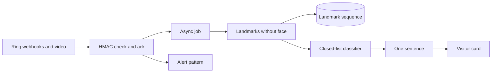
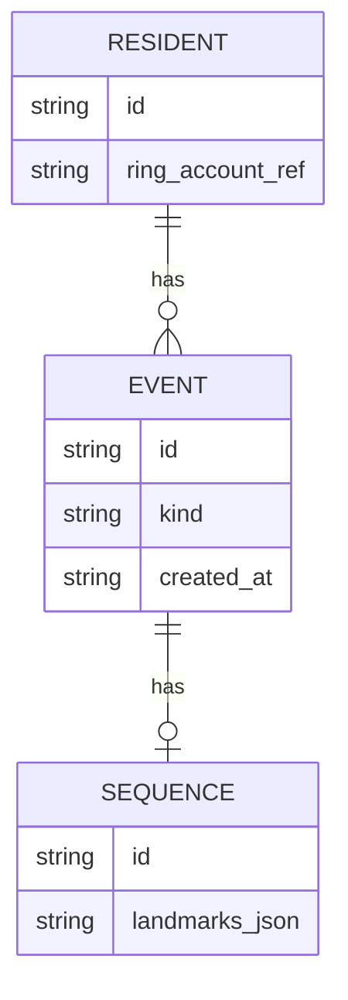
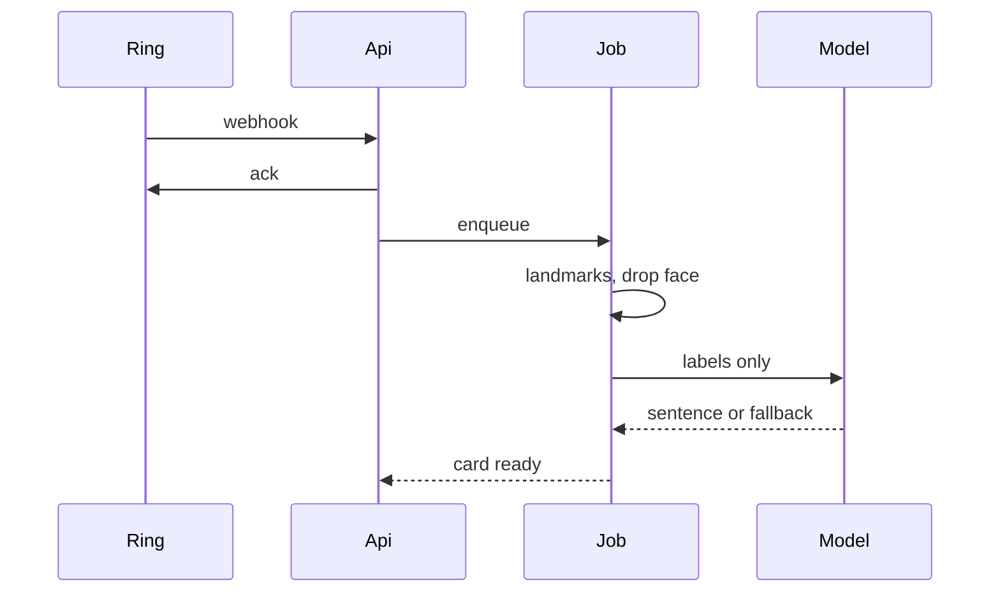

# System Design (SDD)

**Project:** SignSync
**Date:** 2026-10-12
**Version:** 0.1
**Owner:** Xander
**Status:** Draft
**Last reconciled:** N/A
**PRD:** [prd-signsync.md](prd-signsync.md)

---

## 1. Architectural Vision & Principles

1. One ingest path for Playground video and for a labeled clip (PRD-F3).
2. Face landmarks never cross the write boundary (PRD-F5).
3. The webhook ack is fast; classification is async (PRD-F1).
4. The sentence is grounded in closed-list labels, not in a free description of the frame (PRD-F4).
5. Secrets stay outside the repo. Exact store: [FILL].

---

## 2. High-Level Architecture

Components: webhook receiver, job runner, landmark extractor, classifier, sentence call, card API, alert dispatcher. Hosting for the demo is [FILL]. Lambda or a single process are both viable; that choice is reversible and is not a second RFC.

---

## 3. Data Architecture

Residents and events are the only entities this slice stores. Landmark sequences store coordinates after the face drop, not pixels, unless a demo clip is kept separately and labeled. Clip retention is [FILL].

No face column. No plate column. Raw frame retention: [FILL], default none.

---

## 4. API Design & External Integrations

| Method | Path | Purpose | Feature |
|--------|------|---------|---------|
| POST | /webhooks/ring | HMAC webhook, ack, enqueue | PRD-F1 |
| GET | /card/latest | Card for the resident | PRD-F2 |
| POST | /oauth/callback | Finish account link | PRD-F1 |
| POST | /demo/clip | Labeled clip through the same ingest | PRD-F3 |

Request: POST /webhooks/ring takes the Ring body and signature header. Response: 2xx ack within the Ring window. The window value is [FILL] (IDEA.md says 5 seconds; not re-verified here).

Request: GET /card/latest returns event kind, sentence, confidence band, and a hands-only skeleton reference. It does not return a face image.

Request: POST /demo/clip accepts a clip id the team recorded. Response: the same card payload, with source labeled clip.

Ring and Bedrock failure modes:

| Dependency | Failure | Behavior |
|------------|---------|----------|
| Ring webhook | Bad signature | 4xx, no job, no card |
| Ring video | Timeout or empty | Card shows the event kind and "no video" |
| Classifier | Unknown sequence | PRD-F4 fallback, no invented sentence |
| Bedrock | Timeout or error | Event kind plus "not recognized" |
| OAuth | Denied | Stay on the link screen |

### 4.1 Runtime sequences

N/A: single-hop does not apply. The ack and the model call are separate hops.

---

## 5. Security & Authorization

- Verify HMAC before enqueue. Secret location: [FILL].
- Resident routes require the linked account. No anonymous card.
- Demo clip route is team-only for the hackathon. How it is locked: [FILL].
- No payment path (PRD-F7 is Won't-Have).
- Logs omit raw video, landmark blobs, and sentence text that quotes a visitor. Log fields: [FILL].

---

## 6. Infrastructure, CI/CD & Deployment

None yet. Level is L0 in [state.md](state.md). CI, preview, and deploy commands are [FILL]. The demo may run on a laptop. That is not production.

---

## 7. Non-Functional Requirements

| Topic | Target | Status |
|-------|--------|--------|
| Webhook ack | Inside the Ring window | [FILL] |
| Card text after frames | Demo budget | [FILL] |
| Availability | Demo window only | No SLO |
| Privacy | No face landmarks stored | Design only, PRD-F5 |

---

## 8. AI / Agent Architecture

Classifier: sequence of hand and body landmarks to a closed label set (PRD-F3). Sentence: labels plus event kind to one sentence (PRD-F4). The sentence model must not receive pixels or face landmarks (PRD-F5).

Training data: team recordings and, if the license allows, a public landmark set. License check: [FILL].

### 8.1 AI Safety & Threat Surface

Untrusted input is the webhook body, the clip, and any text that might be copied into the prompt. The prompt is built from labels the classifier emitted, not from raw visitor speech, unless PRD-F6 is later turned on.

Abuse: a clip that tries to make the model claim an emergency. Mitigation: closed labels only, confidence note required, no automatic action. Red-team cases live in the QAD.

### 8.2 AI craft (when Section 8 applies)

- Prompt is a template with slots for labels and event kind. Exact text: [FILL].
- Temperature and model id: [FILL].
- Refuse to answer if the label list is empty.
- Do not add tools that unlock a door or message the visitor.

---

## Self-Check

- [x] Must-Haves PRD-F1, PRD-F2, PRD-F3, PRD-F4, and PRD-F5 are cited
- [x] Stories US-1 through US-5 are covered by the card, alert, and face-drop paths
- [x] Integrations have failure rows
- [x] Unknowns are [FILL]
